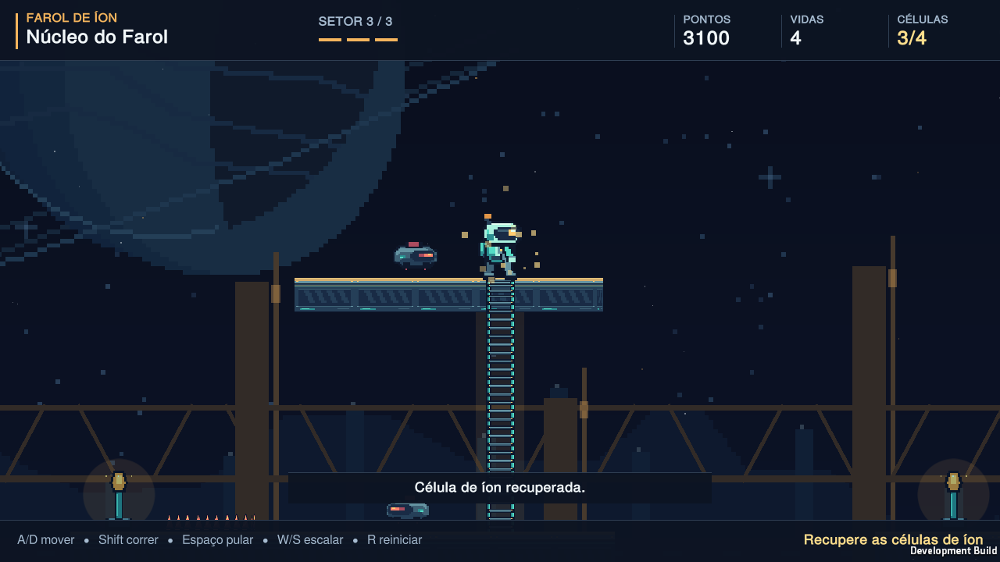

# Farol de Íon

Um jogo de plataforma 2D na Unity. A luz da estação orbital se apagou. Guie o robô de manutenção Nilo por três setores, recupere as células de íon e restaure o sinal que orienta as naves da região.

## Como jogar

| Ação | Teclas |
| --- | --- |
| Iniciar | Enter ou botão **Iniciar missão** |
| Andar | A/D ou ←/→ |
| Correr | Shift + direção |
| Pular | Espaço. Segure para subir mais alto. |
| Escalar | W/S ou ↑/↓ junto à escada |
| Abrir a saída | E perto da comporta, após recuperar todas as células |
| Reiniciar a missão | R |

As **Docas de Serviço** ensinam o salto e a escalada. A **Estação de Bombeamento** combina desníveis, lacunas e patrulhas. O **Núcleo do Farol** exige saltos com corrida e explora rotas verticais mais longas. O HUD acompanha pontuação, vidas e células do setor. Ative as balizas para voltar ao último ponto seguro após perder uma vida.

[Menu](Capturas/01-menu.png) · [Docas de Serviço](Capturas/02-docas-de-servico.png) · [Estação de Bombeamento](Capturas/03-estacao-de-bombeamento.png) · [Núcleo do Farol](Capturas/04-nucleo-do-farol.png) · [Vitória](Capturas/05-vitoria.png)

## Abrir no Unity Editor

1. Clone o repositório e adicione a pasta raiz do projeto ao Unity Hub.
2. Abra com **Unity 6.6.10f1** e aguarde a importação.
3. Abra `Assets/Scenes/Farol.unity` e pressione **Play**.

Para exportar no editor, use **Farol de Íon → Exportar para Linux** ou **Exportar para Windows**, conforme o módulo de suporte instalado. O build Linux fica em `Builds/Linux`. Mantenha a pasta de dados e as bibliotecas junto ao executável `FarolDeIon.x86_64`.

## Verificação

O teste automatizado no executável Unity percorreu os três setores, coletou as nove células e chegou à vitória com quatro vidas e 3.850 pontos. Em uma segunda partida, confirmou a perda de vida por queda, o retorno ao início, a derrota e a restauração das quatro vidas ao reiniciar.

Para repetir o teste no Linux, execute `FarolProject.BuildLinuxSmoke` pelo editor em modo batch. Rode `Builds/Smoke/FarolDeIon.x86_64 -farol-smoke -farol-captures <diretório>` em uma sessão gráfica. A saída `FAROL_SMOKE_PASS` confirma o percurso.

## Estrutura

- `Assets/Scripts/BeaconGame.cs` contém a movimentação, as colisões e as regras da campanha.
- `Assets/Scripts/BeaconLevel.cs` contém os dados geométricos, as rotas de patrulha e os itens dos três setores.
- `Assets/Scripts/BeaconGame.Presentation.cs` e `BeaconGame.Interface.cs` cuidam do cenário, HUD, animações e áudio.
- `Assets/Resources/Animation` contém clipes e controladores nativos do Unity Animator.
- `Assets/Resources/Sprites` e `Assets/Resources/Audio` contêm arte em pixel, efeitos e trilha originais. `Tools/generate_assets.py` reproduz esses arquivos com Pillow e NumPy.
